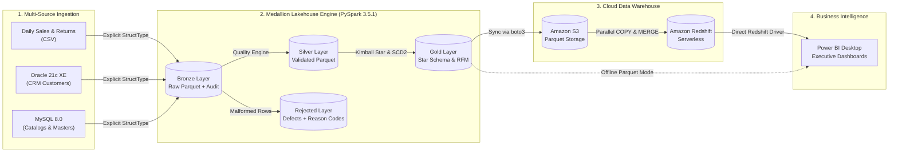

# Retail Sales Analytics & Customer Insights Platform

[](https://www.python.org/)
[](https://spark.apache.org/)
[](https://www.docker.com/)
[](https://aws.amazon.com/redshift/)
[](https://powerbi.microsoft.com/)
[](LICENSE)

An enterprise-grade, end-to-end Data Engineering, Data Warehousing, and Business Intelligence platform built with **PySpark**, **Docker Compose** (Oracle XE & MySQL), **Apache Parquet**, **Amazon Redshift Serverless**, and **Power BI Desktop**.

---

## 1. Project Brief & Executive Summary

Retail enterprises face fragmented data silos across transaction logs, customer relationship management (CRM) systems, and operational supply chain catalogs. This platform provides a centralized, highly reliable Lakehouse Medallion architecture that:
1. **Ingests** daily sales and returns CSV files, Oracle 21c CRM customer tables, and MySQL master catalogs (products, stores, suppliers, promotions).
2. **Validates & Cleanses** data via a deterministic quality engine that rejects malformed records (null IDs, negative quantities, invalid dates, malformed emails) to a dedicated rejection layer while guaranteeing 100% mathematical row reconciliation (`Bronze = Silver Valid + Rejected`).
3. **Models** curated data into a Kimball Star Schema with **SCD Type 2** customer history, nets customer returns, and computes automated **RFM (Recency, Frequency, Monetary) segmentation**.
4. **Loads** curated Parquet data to **Amazon Redshift Serverless** using an idempotent staging and atomic MERGE pattern.
5. **Visualizes** KPIs, time intelligence, vendor risk, and customer cohorts across 4 executive **Power BI** report pages.

---

## 2. End-to-End Architecture



---

## 3. Technology Stack & Verified Versions

| Category | Component | Version | Role / Purpose |
|---|---|---|---|
| **Language** | Python | `3.12.7` | Pipeline code, data generation, test suites |
| **Distributed Engine**| PySpark | `3.5.1` | Ingestion, ETL, windowing, and dimensional modeling |
| **Java Runtime** | OpenJDK | `17.0.12` | JVM runtime for Apache Spark |
| **File Format** | Apache Parquet | Snappy | High-compression columnar storage across all layers |
| **RDBMS (CRM)** | Oracle XE | `21.3.0` | `gvenzl/oracle-xe:21-slim-faststart` via Docker |
| **RDBMS (Masters)** | MySQL | `8.0` | Product, store, supplier, and promotion catalogs |
| **JDBC Drivers** | Oracle JDBC / MySQL Connector | `23.6` / `9.1` | High-throughput Spark JDBC connectors |
| **Cloud Warehouse** | Amazon Redshift | Serverless | Columnar MPP analytical data warehouse |
| **Cloud Storage** | Amazon S3 | `s3a://` | Object storage staging for Redshift `COPY` |
| **Visualization** | Power BI Desktop | Latest | Star schema modeling, DAX time intelligence, dashboards |

---

## 4. Repository Structure

```text
hackathon-project/
├── .env                              # Environment secrets and credentials (gitignored)
├── .env.example                      # Template for environment variables
├── docker-compose.yml                # Oracle 21c XE & MySQL 8.0 containers
├── requirements.txt                  # Python dependencies
├── config/
│   ├── config.yaml                   # Central project configuration
│   └── logging.yaml                  # Centralized logging specifications
├── data/                             # Lakehouse data directory (gitignored)
│   ├── raw/                          # Raw base datasets
│   ├── generated/                    # Synthetic daily CSVs and DB master seeds
│   ├── bronze/                       # Raw Parquet tables with audit metadata
│   ├── silver/                       # Validated clean Parquet tables
│   │   └── rejected/                 # Segregated defect rows with reject_reason
│   └── gold/                         # Kimball Star Schema & RFM Analytical Mart
├── dags/
│   └── retail_analytics_dag.py       # Apache Airflow orchestration DAG
├── docs/
│   ├── architecture.md               # Detailed architecture with Mermaid diagrams
│   ├── data_dictionary.md           # Schema dictionaries for all layers
│   └── viva_preparation_guide.md    # 25+ academic & technical interview Q&A
├── hadoop/bin/                       # Windows native Hadoop binaries (winutils.exe, hadoop.dll)
├── jars/                             # JDBC and AWS SDK JARs (Oracle, MySQL, AWS SDK, hadoop-aws)
├── power_bi/
│   ├── dax_measures.txt              # 15+ production DAX measures (Total Sales, YoY, RFM, etc.)
│   ├── power_query_m.txt             # Power Query M scripts for Redshift & Parquet import
│   ├── retail_theme.json             # Corporate accessible visual theme JSON
│   └── dashboard_build_guide.md      # Visual-by-visual instructions for 4 report pages
├── scripts/
│   ├── validate_phase1.py            # Environment & dependency validation
│   ├── validate_phase2.py            # Data generation validation
│   ├── validate_phase3.py            # Bronze ingestion validation
│   ├── validate_phase4.py            # Silver cleansing & reconciliation validation
│   ├── validate_phase5.py            # Gold star schema & RFM validation
│   ├── validate_phase6.py            # Redshift DDL & S3 loader validation
│   ├── validate_phase7.py            # Logging, tests, and DAG validation
│   ├── validate_phase8.py            # Power BI deliverables validation
│   └── validate_phase9.py            # Master documentation validation
├── src/
│   ├── bronze/                       # Bronze ingestion pipelines
│   ├── silver/                       # Silver validation, deduplication, reject routing
│   ├── gold/                         # Gold star schema, SCD Type 2, and RFM calculation
│   ├── generation/                   # Synthetic data generation scripts
│   ├── ingestion/                    # Reusable Spark JDBC & CSV extractors + schemas
│   ├── redshift/                     # S3 uploader, DDL, and staging MERGE scripts
│   └── utils/                        # Spark session factory, logger, config loader
└── tests/
    └── test_transformations.py       # Pytest unit test suite for business transformations
```

---

## 5. Quickstart & Execution Guide

### Step 1: Environment Setup
Ensure Python 3.12, Java 17, and Docker Desktop are installed on your machine.
```bash
# Clone the repository
git clone https://github.com/your-org/retail-sales-platform.git
cd retail-sales-platform

# Create and activate Python virtual environment
python -m venv venv
.\venv\Scripts\activate   # On Windows
source venv/bin/activate  # On Linux/macOS

# Install dependencies
pip install -r requirements.txt
```

### Step 2: Start Database Containers
```bash
# Start MySQL and Oracle XE containers
docker compose up -d

# Verify containers are running healthy
docker compose ps
```

### Step 3: Generate Base Data & Masters
Populate the MySQL catalogs, Oracle CRM customers, and generate 28 daily sales and returns CSV files with 2-5% deliberate defects:
```bash
python -m src.generation.generate_mysql_masters
python -m src.generation.generate_oracle_crm
python -m src.generation.generate_daily_csv
```

### Step 4: Execute Bronze Ingestion
Ingest all raw sources into immutable Snappy Parquet tables with explicit schemas:
```bash
python -m src.bronze.bronze_pipeline
```

### Step 5: Execute Silver Cleansing & Validation
Enforce quality rules, route defective records to `data/silver/rejected/`, and reconcile row counts:
```bash
python -m src.silver.silver_pipeline
```

### Step 6: Execute Gold Dimensional Modeling & RFM
Build the Kimball Star Schema, calculate SCD Type 2 customer histories, and score customers via RFM:
```bash
python -m src.gold.gold_pipeline
```

### Step 7: Load into Amazon Redshift Serverless (Optional Cloud Run)
Sync Gold Parquet files to Amazon S3 and execute parallel staged MERGE loads into Redshift:
```bash
# Set your AWS and Redshift credentials in .env
python -m src.redshift.redshift_loader
```

### Step 8: Run Automated Unit Tests
Verify transformation logic and business rules:
```bash
pytest tests/ -v
```

---

## 6. Power BI Reporting Pages

The Power BI model connects to the curated warehouse and delivers 4 interactive analytical pages (see [`power_bi/dashboard_build_guide.md`](file:///c:/Users/RAKSHIT/Desktop/hackathon-project/power_bi/dashboard_build_guide.md)):
1. **Executive Overview**: High-level KPI cards (Total Sales, Orders, AOV, Return Rate %), Monthly Sales vs Last Year, Top 10 Products by Net Revenue, and regional slicers.
2. **Product & Supplier Performance**: Category and sub-category sales matrix, supplier risk scatter chart (Revenue vs Return Rate %), and supplier scorecards.
3. **Customer Insights & RFM Segmentation**: Treemap of customer RFM tiers, Recency vs Monetary scatter plot, and targeted customer cohort drilldowns.
4. **Promotions & Returns Analytics**: Promotional lift analysis, Pareto chart of return reasons, and margin erosion tracking.

---

## 7. Master Validation Suite

Run all validation scripts sequentially to verify every phase of the project:
```bash
python scripts/validate_phase1.py
python scripts/validate_phase2.py
python scripts/validate_phase3.py
python scripts/validate_phase4.py
python scripts/validate_phase5.py
python scripts/validate_phase6.py
python scripts/validate_phase7.py
python scripts/validate_phase8.py
python scripts/validate_phase9.py
```

---

## 8. Academic & Viva Voce Reference

For deep-dive technical explanations on PySpark memory optimization, Kimball dimensional modeling, Slowly Changing Dimensions, Redshift distribution keys, and data quality design patterns, consult [`docs/viva_preparation_guide.md`](file:///c:/Users/RAKSHIT/Desktop/hackathon-project/docs/viva_preparation_guide.md).
